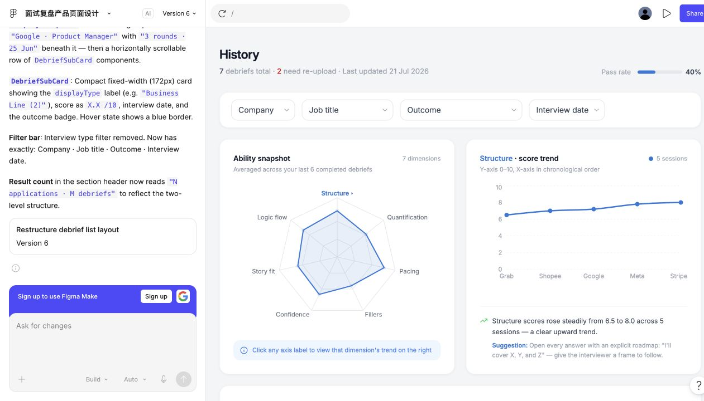

# Candid — History Module Design

**An early-stage product design case study by Yijin Chen**

Helping interview candidates revisit past debriefs, understand progress across interview rounds, and identify what to practise next.

[Figma prototype](https://www.figma.com/make/ImffvjxEunYeFDk3gbnzvP/面试复盘产品页面设计?p=f) · [Current product](https://web-production-71812.up.railway.app/)

## My Contribution

I contributed to the **early design of the History module**, using Figma Make to explore the information hierarchy and interaction patterns for reviewing interview records. This case study documents that bounded design contribution.

**I was not the developer of the full Candid product.** The production application's engineering, AI analysis pipeline, authentication, Story Bank, and other modules are outside my stated contribution. The current product may differ from this early prototype; its link provides context, not evidence that I built every feature.

| Scope | Details |
| --- | --- |
| Role | Early-stage History module design contributor |
| Deliverable | Interactive History page prototype |
| Tool | Figma Make, with AI-assisted prototyping |
| Focus | Information architecture, record retrieval, progress visibility, and recovery states |
| Evidence | The linked prototype and its visible iterations |

## Design Problem

An interview history page needs to do more than store a chronological list. A candidate may be applying to several companies, attending multiple rounds for one role, and trying to understand whether their performance is improving.

The design addresses three product questions:

- How can candidates find the relevant interview without losing its company and role context?
- How can individual debriefs connect to an understandable picture of progress?
- How can the interface distinguish a failed audio-processing job from an unsuccessful interview outcome?

These are design goals reflected in the prototype, not claims of validated user research.

## Design Direction

| Decision shown in the prototype | Intended user benefit |
| --- | --- |
| Filters for company, job title, outcome, and interview date | Narrow a growing set of records using familiar application details |
| Completed records grouped by company and job title | Keep the rounds of one application together |
| Chronological round cards, including numbered repeated round types | Distinguish similar sessions within the same application |
| Sort by newest upload or interview date | Support both recent activity and interview chronology |
| Ability snapshot linked to a selected dimension's trend | Move from a broad overview to a specific practice focus |
| A separate “Needs reupload” section | Make technical failures actionable without implying rejection |
| Question-category distribution and an editable low-confidence classification | Make AI categorization inspectable and allow correction in the prototype |

## User Flow

1. Open History and review the ability snapshot and score trend.
2. Filter records by application context or outcome.
3. Find a company–role group and compare its interview rounds.
4. Review the selected dimension's suggested practice focus.
5. If processing failed, use the re-upload action to return to the debrief flow with context preserved in the prototype.

## Iteration Highlights

The visible Figma Make history shows the design moving from a flat timeline to grouped application records. It also separates processing failure from hiring outcome, simplifies repeated card metadata, standardizes the interface in English, and removes the interview-type filter as the grouped round structure develops.

These changes support a clearer information hierarchy: **application → interview round → debrief**, alongside a distinct recovery path for technical problems.

## Figma Prototype

[Explore the interactive History prototype](https://www.figma.com/make/ImffvjxEunYeFDk3gbnzvP/面试复盘产品页面设计?p=f).

The screenshot documents the prototype, not the production product. Company names, interview records, scores, pass rates, and chart values are illustrative demo data; they are not user outcomes or project impact metrics. Some demo counts are inconsistent across sections and would need reconciliation before a production handoff.

## Current Product

[Visit Candid / Can Did](https://web-production-71812.up.railway.app/).

The current landing page presents audio upload, interview debriefs, a Story Bank, and progress tracking. This broader product is included to show the context in which History sits. This repository contains a design case study, not Candid's production source code.

## Product Reflection & Next Validation

The prototype brings record management, progress interpretation, and error recovery into one surface. Its effectiveness still needs validation. A next research round could measure whether candidates can locate a specific interview, distinguish a processing failure from a hiring outcome, and identify a useful next practice action. No completion-rate, retention, or interview-success improvement is claimed here.

**中文简介：** 我参与了 Candid 初期 History 板块的设计，重点探索面试记录筛选、公司与岗位下的多轮面试分组、能力趋势展示及处理失败后的重传路径。此仓库仅展示这部分设计贡献。
